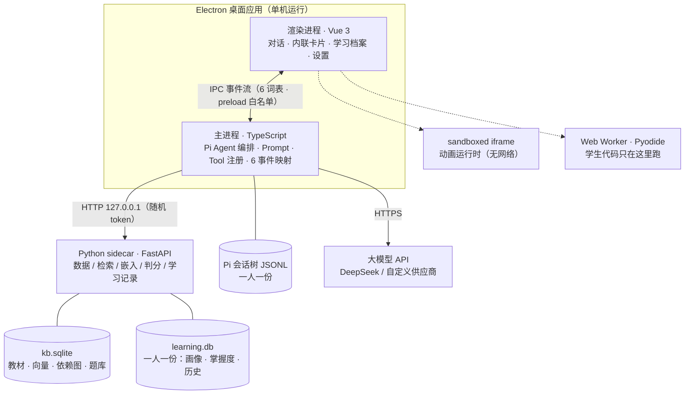

<div align="center">


# 智团团

**K12 人工智能通识课 · 对话教学助手**

一只抱着蜂窝的小熊「团团」，7×24 在线当孩子们的 AI 老师

学段自适应 · 多模态交互 · 个性化学习路径 · 数据全本地

[](#快速开始)
[](#技术栈)
[](#技术栈)
[](#技术栈)
[](#测试与质量守卫)
[](#设计与取舍)

</div>

---

## 这是什么

面向**小学低年级 / 小学高年级 / 初中 / 高中**四个学段的人工智能通识课教学助手，
以 Electron 桌面应用形态交付（本期只做 Windows `.exe`），**全程单机运行、不做服务器部署**。

它能陪学生做四件事，也是产品的四条核心交互线：

| 交互线 | 学生看到什么 | 关键实现 |
| --- | --- | --- |
| **对话问答** | 用自己学段的语气讲知识、追问、举例 | System Prompt 按学段整份替换（童话拟人 ↔ 严谨推导） |
| **动画讲解** | 概念被演出来：变量是盒子、梯度是下山 | 模板优先 + 自由生成，校验重试后仍失败则降级文字/静态图 |
| **编程环境** | 改两行代码就跑，报错能看懂，卡住有分级提示 | Monaco 编辑器 + Pyodide（本地自托管，独立 Worker） |
| **游戏化练习** | 闯关答题、拿掌握度、解锁下一关 | 客观题后端判分、主观题批改、错题进错题本 |

围绕这四条线，再加上三件「让老师省心、让家长看得见」的事：

- **教材检索（RAG）**：四学段教材（**57 个概念 × 四学段 = 228 个知识点 / 8 章 / 483 条依赖边**，
  由根目录 `K12KnowledgeBase/` 导入，第 8 章「编程实践」为本项目自写的补充章）入 `kb.sqlite`，
  检索严格按学段隔离（写在 SQL 层），回答带 `citation` 出处；模型不可用时走
  **四级降级链 `vector → cloud → FTS5 → 依赖图/大纲`**，并如实告知「本次检索能力受限」。
- **个性化闭环**：学生画像（掌握度 / 偏好 / 错题摘要）**每轮**进 Prompt；模型可主动记偏好；
  另有学习报告、错题本、章节进度、学习地图与历史会话回看组成的**学习档案**。
- **主动发起对话**：新会话建立、学生还没开口时，助手先提一句「我们从哪里开始」——
  指向依赖图推荐出的那个知识点（这是全应用**唯一一处「AI 先开口」**）。
  没有依据时（知识库不可用 / 已全部掌握）**不发**，而不是弹一句对谁都成立的寒暄。
- **会话续聊与重启恢复**：对话页左侧列出该学生的历史对话，点一条就能接着聊；
  关掉应用再打开自动续上最近一条，上一段对话还在（数据一直存在 Pi 的会话树里）。
- **学段与章节**：默认从对话里自动推断学段并生效，学生也可**手动指定**（手动后 10 轮冷却回归自动）；
  还可选定「当前在学哪一章教材」作为软偏好。

界面分八个页面：对话 · 动画 · 编程 · 闯关 · 学习档案 · 教材知识库 · 依赖图谱 · 设置
（导航不引入 `vue-router` —— Electron 单窗口没有 URL / 后退 / 深链需求，
唯一真相是 `stores/ui.ts` 的 `PAGES` 表，见 `decisions.md` 的 D-040）。

## 架构

混合后端（**Python 管数据，TypeScript 管编排**），两端只经冻结契约通信：



四条硬边界（违反任一条即架构事故，`desktop/tests/architecture-guards.test.ts` 有守卫）：

| 边界 | 规则 |
| --- | --- |
| **数据域只在 Python** | SQLite 读写、检索降级链、嵌入、判分、学习记录全部在 `server/`；TS 侧不碰数据库、不自己拼 SQL、不算向量 |
| **编排域只在 TypeScript** | 主 Agent 编排、Prompt、Tool 定义与注册、事件映射全在 `desktop/src/main/`；Python 侧不调用任何 LLM |
| **契约面只走冻结契约** | `server/app/contracts.py`（pydantic）→ OpenAPI → 生成 TS 类型；`npm run check:api` 做字节比对，禁止手写兜底接口 |
| **执行面只在渲染进程** | 学生代码只在 Pyodide Worker 里跑，**绝不在主进程**（Pi 扩展与 UI 同进程且拥有完整系统权限） |

## 快速开始

**环境要求**：Windows 10/11、[Node.js](https://nodejs.org/) ≥ 22.19、[uv](https://docs.astral.sh/uv/)、一枚大模型 API Key（默认走 DeepSeek）。

后端依赖与数据先备好（首次约需下载 90MB 嵌入模型）：

```bash
cd server
uv sync                                              # Python 3.12 依赖（uv 锁定）
uv run python scripts/fetch_embedding_model.py       # 取嵌入模型 bge-small-zh-v1.5（约 90MB）
uv run python scripts/import_knowledge.py --write    # 教材由根目录 K12KnowledgeBase/ 导入（幂等，可重跑）
uv run python scripts/build_kb.py                    # 教材 → kb.sqlite（分块 + 向量 + FTS5 + 依赖图）
```

再起桌面端（`npm run dev` 会**自动拉起**上面的 sidecar，端口由系统随机分配）：

```bash
cd desktop
npm install
npm run dev
```

首次启动后进 **设置** 页填供应商与 API Key（供应商 / BaseURL / ModelID / Key 四项都可自填，
也可从 Pi 内置的 40 个供应商预设里挑一个，端点与模型清单会带出来），保存时会真去调一次该地址做连通性探测。

## 构建

**构建链是联动的**：`npm run build` 会**先确保 Python sidecar 是最新的**，再编前端；
出包命令在 electron-builder **之后**校验**装进包里的那一份**后端，指纹不对就非零退出。

```bash
cd desktop
npm run typecheck        # vue-tsc，契约漂移的第一道防线
npm test                 # 765 项 node --test + check:api + check:tool-schema
npm run build            # 先确保 sidecar 最新（过期内自动重打）→ 再编主/渲染进程
npm run build:unpack     # 免安装目录（★ 验证 esbuild 原生依赖是否解包、Pi 能否加载、后端是否最新）
npm run build:win        # 出 .exe（NSIS 安装包 + 绿色便携版）
```

### 为什么需要「联动」这一步

sidecar 是**独立打包的产物**（PyInstaller → `server/dist/k12-agent-server/`），
它**不随** `electron-vite build` 更新；而 `electron-builder` 只是把磁盘上**现成的那份** exe
拷进安装包（`extraResources`）。于是「改了 `server/` 却没重打」的包能顺利构建、
能过**全部单测**（单测测的是源码），只是**包里跑着几天前的后端** ——
新端点回 404、源码里早修好的 bug 还活着，且**不报任何错**。

这不是假设，是实测踩到的坑（`docs/report-material/pitfalls.md` 的 **P-072**）：包里的 sidecar
是 9-17 05:01 的，而修复是 9-18 13:52 才进的源码；同一份过期产物也缺 9-18 新增的 4 个知识库端点。

所以现在由**构建链自己**保证，而不是靠「记得先跑」：

| 机制 | 文件 | 作用 |
| --- | --- | --- |
| **源码指纹** | `server/scripts/build_info.py` | 对会进包的文件按路径排序做 sha256（`app/` `scripts/` `packaging/` `knowledge/` `resources/` + `pyproject.toml` `uv.lock`；`resources/models/` 的 91MB ONNX 只记大小；`tests/`、`dist/`、`resources/kb/` 不参与） |
| **写指纹 + 自检** | `server/scripts/build_server.py` | 打包**前**算指纹 → 打包 → 写 `<dist>/build-info.json`；`--verify` 断言「产物指纹 == 当前源码指纹」；`--if-stale` 新鲜就秒退 |
| **JS 侧比对** | `desktop/scripts/build-server.mjs` | 只**调用** Python 取指纹（不自己算哈希，两套算法必然漂移）；挂在 npm 脚本上 |

```bash
npm run check:server              # 查 server/dist 里的那一份是不是当前源码打的
npm run check:server:packaged     # 查**已装进安装包**的那一份
```

构建链会在这些时刻自动拦住你：

| 情形 | 行为 |
| --- | --- |
| 源码未动，跑 `npm run build` | **1.3s 秒退**（`[skip] sidecar 已是当前源码打的`） |
| 改过 `server/` 任一文件 | 完整重打：建库 → PyInstaller → **26 项产物自检**（约 54s） |
| 包里那份后端与源码不符 | **非零退出**，并给出可执行的修法 |

四个刻意的设计选择：**缺指纹的旧产物一律判过期**（宁可多重打一次，也不要「过期却判新鲜」）；
**`tests/` 不进指纹**（改个测试不该触发几分钟重打包，否则大家会想办法绕过检查）；
**按文件内容而非 git commit 判新旧**（否则「改了没提交直接打包」会被判新鲜）；
**逃生舱会响**（`K12_SKIP_SERVER_BUILD=1` 打印警告后跳过——静默跳过正是这套机制要消灭的东西）。

## 目录结构

```
K12Agent/
├─ desktop/                 Electron + Vue 桌面端
│  ├─ src/main/             主进程：sidecar 生命周期 / Pi Agent 编排 / IPC / 6 事件映射
│  ├─ src/preload/          IPC 白名单（渲染进程唯一的桥，token 永不进入渲染进程）
│  ├─ src/renderer/         Vue 3 界面：八页面 + 内联卡片
│  ├─ src/shared/           跨进程类型 · 品牌名（唯一来源）· 供应商目录
│  ├─ scripts/              构建联动（build-server.mjs）· 契约生成 · 各类冒烟与证据脚本
│  ├─ tests/                765 项回归（含架构守卫 G1–G13 · G18–G23 组）
│  └─ build/ resources/     打包图标 · 学段 logo · Pyodide 运行时（本地自托管）
├─ server/                  Python sidecar
│  ├─ app/                  FastAPI：contracts / routes / rag / safety / store / grade
│  ├─ knowledge/            四学段教材（228 知识点 · 8 章 · 483 依赖边，由 K12KnowledgeBase/ 导入）
│  ├─ knowledge-supplement/ 第 8 章「编程实践」（本项目自写，3 概念 × 四学段）——与用户源库分开存放
│  ├─ resources/            题库（`quizbank/`，按章分片 ch01–ch08）· 动画模板 · 代码模板 · 敏感词表
│  ├─ scripts/              导入教材 / 建库 / 取模型 / 导出 OpenAPI / 打包+指纹 / 生成品牌图标
│  └─ tests/                1031 项回归
├─ K12KnowledgeBase/        教材源库（用户提供，54 概念 × 四学段；本项目只读地用 import_knowledge.py 导入）
├─ docs/                    设计文档 · 任务票 · 决策与踩坑素材 · 界面版式契约 · 对标材料
├─ logos/                   品牌原图（2048²，不入包）
├─ AGENTS.md                面向编码代理的工作区说明
└─ 项目执行文档.md            唯一权威执行文档（范围 / 契约 / DDL / 排期 / 验收）
```

## 技术栈

| 层 | 选型 |
| --- | --- |
| 桌面壳 | Electron 44 + electron-vite 5 + Vite 7 + Vue 3.5 + Pinia 4 + TypeScript 5.9（strict） |
| 组件与样式 | Element Plus（按需引入）· lucide 图标 · 设计 token 由 `tokens.source.json` 生成（6 组配色 × 3 档饱和度 = 18 套，正文 16px 基准） |
| Agent 编排 | Pi Agent SDK `@earendil-works/pi-coding-agent ^0.85.1`（主进程内嵌；6 个 Extension / 10 个 Tool） |
| 后端 | Python 3.12（uv 锁定）+ FastAPI + uvicorn + pydantic v2（契约唯一来源） |
| 数据 | `kb.sqlite`（只读知识库：chunk / 向量 / FTS5 / 依赖图 / 题库）· `learning.db`（一人一份）· Pi JSONL 会话树（一人一份） |
| 检索 | sqlite-vec 向量检索 → 云端嵌入兜底 → FTS5（trigram 分词）→ 依赖图/大纲，四级降级一次调用内走完 |
| 嵌入 | fastembed `BAAI/bge-small-zh-v1.5`（512 维 ONNX，纯 CPU，**不依赖 Ollama / torch**） |
| 多模态 | Anime.js v3（sandboxed iframe）· Monaco Editor · Pyodide（独立 Web Worker） |
| 传输 | 渲染进程 ↔ 主进程：IPC 事件流，事件词表冻结为 `delta / citation / payload / blocked / done / error`；主进程 ↔ sidecar：`127.0.0.1` HTTP + 随机 token |
| 打包 | electron-builder（NSIS + 绿色便携版）· PyInstaller `--onedir` · **构建联动 + 源码指纹校验**（见上） |

## 设计与取舍

- **为什么保留 Python sidecar 而不是全单进程**：数据、检索、嵌入、判分这些活儿的生态在 Python（sqlite-vec / fastembed），
  而编排与 Tool 的生态在 TypeScript（Pi）。硬凑成一种语言，必然有一半要用不合适的工具写。
  代价（跨语言契约、双进程生命周期）**是用冻结契约 + 守卫测试换掉的**，这是主动权衡而非妥协。
- **动画「模板优先 + 生成补充」**：自由生成不稳定，所以先查模板、再让模型生成，产物必须过校验，
  重试共享一个总预算，仍失败就降级成文字 + 静态图——**宁可朴素，不可白屏**。
- **零 CDN**：动画库内联进产物、Pyodide 与 Monaco 本地自托管，断网演示不翻车。
- **一人一库、Pi 会话显式改道**：未成年人数据最小化采集，`learning.db` 与 Pi 会话树都按学生隔离，
  存储目录名与品牌名解耦（改品牌不会把学生的数据「改丢」）。
- **内容安全的第二道是「先说完再撤」**：流式输出照常，生成结束后整段终审，违规则撤回并替换为安全提示；
  输入侧的匹配会先做归一化（零宽字符、全角、分隔符拆分都无法绕过）。
- **把人记住改成机器检查**：构建链的顺序纪律（P-072）写进文档无效——文档没有退出码。
  凡是「靠人记得」的环节，都要有一个会失败的检查兜底（见上面的「构建」一节）。
- **明确不做**：绘本生成、多模态教学资源推荐（已砍单）；语音（P2 后置）；不引入 `pi-subagents` 等第三方 SubAgent 包。

## 测试与质量守卫

```bash
cd server  && uv run python -m unittest discover -s tests   # 1031 项
cd desktop && npm test                                      # 765 项 + 契约漂移比对 + Tool schema 一致性 + 文档数字自检
```

回归里有相当一部分是**架构守卫**，写成正向断言而不是「禁止某历史实现」：

- 聊天事件流必须经 preload 白名单 IPC 通道送达；事件名必须是 6 词表之一。
- 学生代码执行必须经 IPC 落到渲染进程的 Pyodide Worker。
- Pi 会话文件必须落在 `students/<id>/` 内（跨学生混放是合规硬伤）。
- 明文 API Key 只允许主进程取用：渲染进程既没有通道、preload 也没有方法。
- 对话请求的字段集合被钉死为 `['text']`——学段、章节的手动修改只能走各自的独立通道。
- **前端构建必须先确保 sidecar 最新**，出包命令必须在 electron-builder 之后校验包里那一份（G20 组）。
- **本文档与 `architecture/index.html` 里登记的数字必须与磁盘一致**（`npm run check:docs`）——
  逐处枚举「数字 + 关键词」，漏改任何一处都红，而不是「有一个对的就算过」。

守卫**验证过会红**：故意改坏 `build` 链路、把校验提到 electron-builder 之前、
在 `extraResources` 里排除 `build-info.json`——G20-1 / G20-2 / G20-3 各自如实失败。
同理，过期产物对着 `build_server.py --verify` 会直接判不通过，而不是给个警告放行。

### UX 体检（真机交互，与单测是**两件事**）

单元测试覆盖的是「我们写下的逻辑」。有一整类缺陷**在逻辑之外** ——
真实模型的输出习惯、真实时序、真实状态、渲染后的几何关系。
`npm test` 与后端测试**全绿**时，下面这些都照样存在过：

| 抓到过的缺陷 | 为什么单测测不到 |
| --- | --- |
| 模型输出里的 `**` 直接露给学生 | 单测样本是**我们自己造的**，模型的输出习惯不是我们定的 |
| 引用块出现时视图掉队 759px | 只在**过程中**发生，终态是好的 |
| 忙时按 Enter 零反馈 | 只在「上一轮还没结束」这个**状态**下发 |
| 浮标压住输入框 17px / 表头被切一半 | 重叠与裁切是**关系**，不在任何单个元素的属性里 |
| 两处下拉既不能 Esc 也不能点外部关闭 | **纯交互属性**，没有逻辑可断言 |

```bash
cd desktop
K12_DEBUG_PORT=9222 npm run dev   # 另一个终端
npm run ux                        # 对话页体检 24 项（键盘/滚动/触控目标/破坏性操作）
npm run ux:pages                  # 逐页体检 28 项（八个页面各查四项）
npm run ux:layout                 # 版式体检 24 格（3 视口 × 8 页：裁切/错位/表格对齐）
npm run ux:scroll                 # 滚动行为 7 项     npm run ux:busy / ux:attribute
```

它抓到的每一条结论都会固化成**源码级守卫**（`tests/ux-*.test.ts`），
且**每条都做过变异验证** —— 把修复改回坏写法，确认断言真的变红。
⚠️ 跑探针前先 `npm run ux:reload`：HMR 改过 `onMounted` 后旧组件不会重跑它，
量出来的现象是「改动完全没生效」，会把人带错方向。

## 文档地图

| 文档 | 用途 |
| --- | --- |
| [`项目执行文档.md`](项目执行文档.md) | **唯一权威**：范围、契约、DDL、排期、验收、风险 |
| [`docs/业务陷阱清单.md`](docs/业务陷阱清单.md) | 各模块领域陷阱与业务验收口径（动手前扫一眼） |
| [`docs/tickets/`](docs/tickets/README.md) | 任务切片（一票一文件，按依赖顺序） |
| [`docs/report-material/`](docs/report-material/README.md) | 决策记录（D-0xx）与踩坑复盘（P-0xx），项目报告的一手素材 |
| [`docs/agents/`](docs/agents/domain.md) | 工程技能约定：tracker 路径、triage 标签、领域文档消费方式 |
| [`docs/ui/`](docs/ui/版式契约.md) | 界面版式契约与原型说明（层次、间距、组件边界） |
| [`docs/对标/`](docs/对标) | 赛题原文与两份对标调研材料 |
| [`AGENTS.md`](AGENTS.md) | 面向后续编码代理的工作区说明（本仓库特有、代码里看不出来的信息） |
| [`docs/tool-trace.mmd`](docs/tool-trace.mmd) | 工具调用轨迹图（Agent 自主路由的证据） |

> 另有一份**本地**的架构总览页 `architecture/index.html`（单文件、可离线打开，19 节 +
> 21 条功能机制清单）—— 它是答辩用的探查产物，**不入库**（见 `.git/info/exclude`），
> 里面的数字由上面的 `check:docs` 一并盯着。

## 备注

- 本项目为**单人 · 15 天极限冲刺**下的赛题交付物，多处「砍单」是有意为之，取舍与代价都写在
  `docs/report-material/` 与执行文档里；已实现的边界同样如实标注，不粉饰。
- 仓库内**不含**学生数据、API Key、嵌入模型（约 90MB）与 Pyodide 运行时（体积大，随包分发），
  这些分别由 `.gitignore` 与各自的获取脚本管理。
- 构建产物（`server/dist/`、`desktop/dist/`、`out/`）不入库；安装包里的后端与前端**由构建链保证同源**
  ——每一份 sidecar 都带着 `build-info.json`（源码指纹 + commit + 构建时间），随时可被校验。
