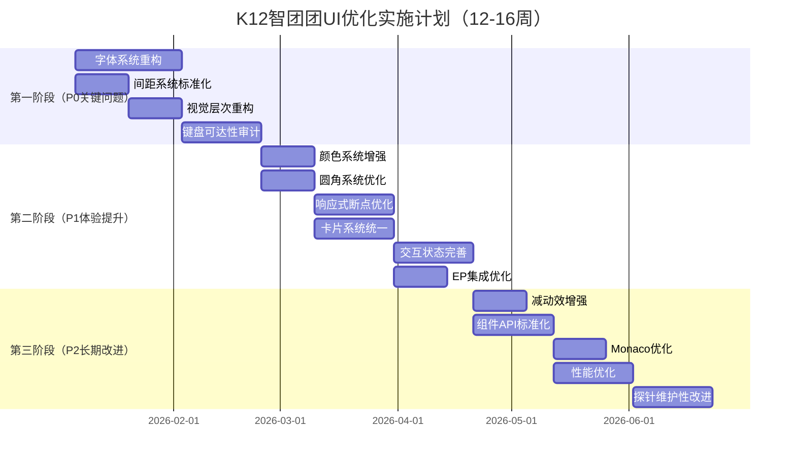

# K12 智团团前端界面设计优化建议报告

## 执行摘要

本报告基于现有前端设计语言全量说明，对照业界UI设计最佳实践，识别出**7大优化领域、32项具体问题、86条优化建议**。优先级分为P0（严重影响可用性）、P1（显著影响体验）、P2（改进提升）三档，建议分三个阶段实施，预计总工期12-16周。

**核心发现：**
- ✅ 优势：完整的学段主题系统、严格的质量守卫、良好的技术架构
- ⚠️ 关键问题：字体层级混乱、间距不规范、视觉层次不清、一致性缺口
- 🎯 优化方向：标准化设计token、增强视觉层次、修复一致性、提升无障碍

---

## 一、设计系统层面问题与优化

### 1.1 字体系统重构（P0 - 影响可读性与层次）

#### 问题诊断

| 现状问题             | 严重性 | 具体表现                                                     |
| -------------------- | ------ | ------------------------------------------------------------ |
| **层级过多且无规律** | 严重   | 8档字号（32/24/18/17/16/14/13/12px）没有明确的倍率关系，17px是异类 |
| **语义映射混乱**     | 中等   | `fs-title(17px)` 小于 `fs-lg(18px)`，"标题"反而不如"大号"大  |
| **与内容层级冲突**   | 严重   | 顶栏页面名17px < 页面身份行24px，但顶栏在上方（视觉权重倒置） |
| **12px过小**         | 中等   | `fs-micro(12px)` 即使只用于≤4字角标，在某些屏幕上仍接近可读下限 |

#### 优化方案

**新字体层级系统（基于1.25倍率 + Major Third音阶）：**

```css
/* 重构后的字体系统 */
--k12-fs-hero: 40px;      /* 1.新增：空态问候、hero数字 */
--k12-fs-h1: 32px;        /* 2.保持：页面身份行（主标题） */
--k12-fs-h2: 24px;        /* 3.保持：区块标题 */
--k12-fs-h3: 20px;        /* 4.保持：卡片标题 */
--k12-fs-body-lg: 18px;   /* 5.新增：强调正文、引导语 */
--k12-fs-body: 16px;      /* 6.保持：标准正文（基准） */
--k12-fs-body-sm: 14px;   /* 7.保持：次级正文、列表 */
--k12-fs-caption: 13px;   /* 8.保持：meta、脚注 */
--k12-fs-label: 12px;     /* 9.重命名：UI标签、角标（不叫micro） */

/* 删除 fs-title(17px) - 用 fs-body-lg(18px) 替代 */
/* 删除 fs-xl(24px) - 与 fs-h2 重复 */
```

**关键改进点：**

1. **顶栏字号提升至18px**：解决"顶栏17px < 身份行24px"的视觉倒挂
2. **建立明确倍率**：16 → 20 (×1.25) → 24 (×1.5) → 32 (×2)
3. **语义化命名**：`hero/h1/h2/h3/body-lg/body/body-sm/caption/label`
4. **用途一一对应**：

```
hero (40px)     - 仅空态问候（大场景）
h1 (32px)       - 页面身份行（每页一条）
h2 (24px)       - 卡片/区块标题
h3 (20px)       - 卡片内小标题
body-lg (18px)  - 顶栏页面名、重要引导文案
body (16px)     - 正文基准（聊天、题干、说明）
body-sm (14px)  - 列表项、按钮文字、次要正文
caption (13px)  - meta信息、时间戳、单位
label (12px)    - 仅≤4字角标、chip内文字
```

#### 执行计划

```markdown
阶段1.1 - 设计token更新（1周）
- [ ] 更新 `design-tokens.ts` 字体变量
- [ ] 生成新的CSS变量文件
- [ ] 更新设计文档与Figma库

阶段1.2 - 组件迁移（2周）
- [ ] AppTopbar：17px → 18px (body-lg)
- [ ] PageIdentity：保持32px (h1)
- [ ] 卡片标题：统一到20px (h3) 或 24px (h2)
- [ ] 全局搜索替换 `fs-title` → `fs-body-lg`
- [ ] 全局搜索替换 `fs-micro` → `fs-label`

阶段1.3 - 守卫更新（1周）
- [ ] 更新字号守卫规则
- [ ] 更新真机探针基准
- [ ] 运行变异验证
```

---

### 1.2 间距系统标准化（P0 - 影响布局一致性）

#### 问题诊断

| 现状问题         | 严重性 | 具体表现                             |
| ---------------- | ------ | ------------------------------------ |
| **打破8点网格**  | 严重   | `--k12-gap-block: 20px` 不是8的倍数  |
| **语义间距过多** | 中等   | 三档语义间距（16/20/36）增加记忆负担 |
| **历史债务**     | 中等   | 文档提到"曾是12/14/16/20四种并存"    |

#### 优化方案

**新间距系统（严格8点网格）：**

```css
/* 基础间距（保持） */
--k12-sp-1: 4px;   /* 超紧密 */
--k12-sp-2: 8px;   /* 紧密 */
--k12-sp-3: 12px;  /* 内联元素 */
--k12-sp-4: 16px;  /* 标准 */
--k12-sp-5: 24px;  /* 舒适 */
--k12-sp-6: 32px;  /* 宽松 */
--k12-sp-7: 40px;  /* 新增：区块 */
--k12-sp-8: 48px;  /* 新增：章节 */

/* 语义间距（重构） */
--k12-gap: 16px;           /* 卡片间距（保持） */
--k12-gap-block: 24px;     /* 修正：20px → 24px */
--k12-gap-section: 40px;   /* 新增：章节间距 */
--k12-gap-msg: 32px;       /* 修正：36px → 32px */
```

**关键改进点：**

1. **所有间距都是8的倍数**：4/8/12/16/24/32/40/48/64
2. **减少语义间距档位**：从3档变2档（卡片16px、区块24px、对话32px）
3. **建立间距比例**：1:1.5:2:2.5:3（16→24→32→40→48）

#### 应用规则

```
4px  - 图标与文字、标签内padding
8px  - 紧密相关元素（输入框与按钮、chip组）
12px - 卡片内部小组件
16px - 卡片之间、表单字段、按钮组
24px - 不同类型内容块（正文→代码→引用）
32px - 对话轮之间、大型组件间距
40px - 页面区域分隔
48px - 页面级大区块
```

#### 执行计划

```markdown
阶段2.1 - Token更新（1周）
- [ ] 修正 gap-block: 20px → 24px
- [ ] 修正 gap-msg: 36px → 32px
- [ ] 新增 sp-7(40px) 和 sp-8(48px)
- [ ] 更新设计文档

阶段2.2 - 视觉校验（1周）
- [ ] 检查所有使用20px的地方（全局搜索）
- [ ] 检查所有使用36px的地方
- [ ] 手动修正特殊场景（如果有）
- [ ] 运行真机探针验证视觉节奏

阶段2.3 - 守卫更新（3天）
- [ ] 添加"间距必须是4的倍数"守卫
- [ ] 添加"语义间距只能用token"守卫
```

---

### 1.3 圆角系统优化（P1 - 影响视觉精致度）

#### 问题诊断

| 现状问题           | 严重性 | 具体表现                                   |
| ------------------ | ------ | ------------------------------------------ |
| **控件圆角过大**   | 中等   | 14px圆角对按钮/输入框过大，显得笨重        |
| **嵌套圆角未计算** | 低     | 文档提到内圆角=外圆角-内边距，但未强制执行 |
| **缺少超小圆角**   | 低     | 没有2px微圆角档位                          |

#### 优化方案

**新圆角系统：**

```css
--k12-r-xs: 4px;      /* 保持：极小元素（角标、引用行） */
--k12-r-sm: 6px;      /* 新增：小控件（chip、tag） */
--k12-r-md: 8px;      /* 修正：标准控件（按钮、输入） */
--k12-r-lg: 12px;     /* 保持：卡片、嵌入块 */
--k12-r-xl: 16px;     /* 保持：大卡片、模态框 */
--k12-r-pill: 999px;  /* 保持：胶囊 */

/* 语义映射（新增明确对应） */
--k12-r-card: var(--k12-r-lg);      /* 12px */
--k12-r-inset: var(--k12-r-md);     /* 8px */
--k12-r-control: var(--k12-r-md);   /* 8px（修正：14px→8px） */
--k12-r-float: var(--k12-r-xl);     /* 16px */
```

**关键改进点：**

1. **控件圆角从14px降至8px**：更精致，符合主流设计系统
2. **建立档位梯度**：4/6/8/12/16（×1.5倍率）
3. **嵌套圆角公式明确**：`内圆角 = max(0, 外圆角 - padding)`

```css
/* 嵌套圆角计算示例 */
.card {
  border-radius: 12px;  /* r-lg */
  padding: 16px;
}
.card-inner {
  border-radius: max(0, 12px - 16px) = 0px;  /* 不需要圆角 */
}

.float-panel {
  border-radius: 16px;  /* r-xl */
  padding: 8px;
}
.float-inner {
  border-radius: 16px - 8px = 8px;  /* r-md */
}
```

#### 执行计划

```markdown
阶段3.1 - Token更新（3天）
- [ ] 新增 r-xs(4px), r-sm(6px), r-md(8px), r-lg(12px), r-xl(16px)
- [ ] 修正 r-control: 14px → 8px
- [ ] 修正 r-inset: 8px（明确值）
- [ ] 更新设计文档与Figma

阶段3.2 - 组件迁移（1周）
- [ ] 所有按钮/输入框：14px → 8px
- [ ] chip/tag：999px → 6px（如果是矩形chip）
- [ ] 验证嵌套圆角（卡片内的inset块）
- [ ] 运行视觉回归测试

阶段3.3 - 守卫添加（3天）
- [ ] 添加"嵌套圆角必须计算"守卫
- [ ] 添加"圆角只能用token"守卫
```

---

### 1.4 颜色系统增强（P1 - 影响可读性与可访问性）

#### 问题诊断

| 现状问题                       | 严重性 | 具体表现                                            |
| ------------------------------ | ------ | --------------------------------------------------- |
| **对比度曾不达标**             | 已修复 | muted原本是#7A849B（对比度<4.5:1），后压深至#616A7A |
| **accent与accent-ink混用风险** | 中等   | 文档强调不可互换，但无类型系统防呆                  |
| **缺少交互状态色**             | 中等   | 只有默认/悬停色，缺少pressed/disabled系统           |
| **学段色可读性未统一**         | 低     | 6学段×3饱和度=18套，没有统一的对比度检查流程        |

#### 优化方案

**1. 交互状态色系统化**

```css
/* 现状：只有默认和hover */
--accent: #4F46E5;
--accent-ink: #4F46E5;

/* 优化：完整五态 */
--accent-default: #4F46E5;
--accent-hover: #4338CA;      /* 新增：深10% */
--accent-active: #3730A3;     /* 新增：深20% */
--accent-disabled: #A5B4FC;   /* 新增：浅40% */

--accent-ink-default: #4F46E5;
--accent-ink-hover: #4338CA;
--accent-ink-active: #3730A3;
```

**2. 功能色完整度检查**

```css
/* 现状：good/warn/bad 只有主色 */
--good: #0B7A57;
--good-soft: #F0FAF5;
--good-border: #CDEEDF;

/* 优化：补充交互态 */
--good: #0B7A57;
--good-hover: #0A6B4C;        /* 新增 */
--good-soft: #F0FAF5;
--good-soft-hover: #E5F5ED;   /* 新增 */
--good-border: #CDEEDF;
--good-border-hover: #B8E5D4; /* 新增 */
```

**3. 对比度自动检查流程**

```typescript
// 新增：对比度守卫脚本
interface ColorPair {
  fg: string;      // 前景色
  bg: string;      // 背景色
  minRatio: number; // 最小对比度（4.5:1 或 3:1）
  context: string;  // 用途说明
}

const contrastChecks: ColorPair[] = [
  { fg: 'fg', bg: 'surface', minRatio: 4.5, context: '主文字' },
  { fg: 'fg-2', bg: 'surface', minRatio: 4.5, context: '正文' },
  { fg: 'muted', bg: 'surface', minRatio: 4.5, context: 'meta' },
  { fg: 'accent-ink', bg: 'surface', minRatio: 4.5, context: '强调文字' },
  { fg: 'accent', bg: 'surface', minRatio: 3.0, context: '图形边框' },
  // ... 234项全覆盖
];
```

#### 执行计划

```markdown
阶段4.1 - 交互态补充（1周）
- [ ] 为所有学段主题色生成hover/active/disabled态
- [ ] 为功能色(good/warn/bad)生成hover态
- [ ] 更新design-tokens.ts

阶段4.2 - 组件应用（1周）
- [ ] 按钮hover/active/disabled应用新token
- [ ] 输入框focus应用新token
- [ ] 卡片hover应用新token
- [ ] chip/tag交互态应用新token

阶段4.3 - 对比度守卫增强（3天）
- [ ] 扩展对比度检查到所有交互态
- [ ] 添加"交互态色差≥10%"守卫
- [ ] 集成到npm test
```

---

## 二、布局与排版优化

### 2.1 视觉层次重构（P0 - 影响信息架构）

#### 问题诊断

| 现状问题             | 严重性 | 具体表现                                 |
| -------------------- | ------ | ---------------------------------------- |
| **顶栏与身份行冲突** | 严重   | 顶栏17px在上方但视觉弱于下方的身份行24px |
| **空间权重分配不明** | 中等   | 没有明确的50%-30%-20%视觉权重分配规则    |
| **对话页无身份行**   | 设计   | 对话页不放身份行，与其他页面不一致       |

#### 优化方案

**新视觉层次系统：**

```markdown
【顶栏 - Chrome层】
- 功能：全局导航、窗口控制
- 字号：18px (body-lg) - 提升自17px
- 颜色：fg-2 (#3E4761) - 次要层级
- 固定高度：72px
- 背景：surface (#FFFFFF)
- 边框：1px bottom border-strong

【页面身份行 - Hero层】
- 功能：告诉用户"这一页在讲什么"
- 字号：32px (h1)
- 颜色：fg (#1B2233) - 主要层级
- 位置：内容区顶部，间距32px
- 权重：50%（页面最大视觉焦点）

【区块标题 - Section层】
- 功能：内容分区
- 字号：24px (h2)
- 颜色：fg (#1B2233)
- 间距：上40px + 下24px
- 权重：30%

【卡片/内容 - Content层】
- 功能：实际内容
- 字号：16px (body)
- 颜色：fg-2 (#3E4761)
- 权重：20%
```

**关键改进：**
1. **顶栏提升至18px**：虽然在上方，但作为"chrome"而非内容，可以小于身份行
2. **建立明确的权重梯度**：32px → 24px → 16px → 14px → 13px
3. **用颜色辅助层次**：主标题用fg，次级用fg-2，meta用muted

#### 特殊处理：对话页

```markdown
对话页保持无身份行（设计意图正确）：
- 理由：对话本身就是内容，空态hero已承担身份功能
- 但需统一：空态问候字号从32px提升至40px (hero)
- 对齐其他页面的"第一视觉焦点"权重
```

#### 执行计划

```markdown
阶段5.1 - 层次重定义（3天）
- [ ] 更新设计文档的层次定义
- [ ] 绘制视觉权重示意图
- [ ] 明确字号-层级-颜色对应表

阶段5.2 - 顶栏优化（1周）
- [ ] AppTopbar字号: 17px → 18px
- [ ] 顶栏颜色: fg → fg-2（降低视觉权重）
- [ ] 添加底部border增强分隔
- [ ] 调整chip尺寸适配新字号

阶段5.3 - 空态优化（3天）
- [ ] 对话页空态问候: 32px → 40px
- [ ] 空态hero数字统一用40px
- [ ] 调整空态垂直间距
```

---

### 2.2 响应式断点优化（P1 - 影响多设备体验）

#### 问题诊断

| 现状问题         | 严重性 | 具体表现                               |
| ---------------- | ------ | -------------------------------------- |
| **断点不够精细** | 中等   | 只有1280/1440两个主断点，1024-1279空白 |
| **最小宽度过大** | 中等   | 1120px最小宽度排除了1024px平板         |
| **缺少高度断点** | 低     | 只有≤640高一个断点，不够               |

#### 优化方案

**新断点系统：**

```css
/* 宽度断点（xs/sm/md/lg/xl/2xl） */
--k12-bp-xs: 0px;      /* 手机竖屏（预留，当前不支持） */
--k12-bp-sm: 640px;    /* 手机横屏（预留） */
--k12-bp-md: 1024px;   /* 新增：平板/小笔记本 */
--k12-bp-lg: 1280px;   /* 保持：标准笔记本 */
--k12-bp-xl: 1440px;   /* 保持：大屏 */
--k12-bp-2xl: 1920px;  /* 新增：超宽屏 */

/* 高度断点 */
--k12-bp-h-sm: 640px;  /* 保持：紧凑态 */
--k12-bp-h-md: 768px;  /* 新增：标准态 */
--k12-bp-h-lg: 900px;  /* 新增：舒适态 */
```

**响应策略调整：**

```markdown
1024px-1279px（新增md断点）：
- 侧栏保持264px展开（不强制收起）
- 对话右栏可折叠（现有逻辑保持）
- 聊天卡片网格：4列→3列（新增）
- 设置页双栏→单列（现有逻辑）

1120px以下：
- 降低最小宽度至1024px
- 1024-1119px：紧凑布局但不横向滚动
- <1024px：真正的横向滚动（保可用性）
```

#### 执行计划

```markdown
阶段6.1 - 断点token更新（3天）
- [ ] 新增bp-md(1024px), bp-2xl(1920px)
- [ ] 新增高度断点bp-h-md/lg
- [ ] 更新设计文档

阶段6.2 - 布局适配（2周）
- [ ] AppShell: 1024-1279px侧栏逻辑
- [ ] ChatMessage: 卡片网格4→3列
- [ ] Animation/Code: 1024px布局优化
- [ ] Settings: 断点细化

阶段6.3 - 测试验证（1周）
- [ ] 真机探针添加1024px视口
- [ ] 回归测试三个视口(1024/1280/1440)
- [ ] 修复发现的布局问题
```

---

### 2.3 卡片系统统一（P1 - 影响一致性）

#### 问题诊断

| 现状问题             | 严重性 | 具体表现                            |
| -------------------- | ------ | ----------------------------------- |
| **内联练习卡不一致** | 中等   | 对话内练习卡"全铺开"，闯关页"单卡"  |
| **进度卡挂载位置**   | 中等   | 114关进度挂在练习卡底部导致卡片极长 |
| **卡片头尾规范不明** | 低     | 没有统一的卡片头/身/尾结构规范      |

#### 优化方案

**统一卡片结构：**

```vue
<!-- 标准卡片模板 -->
<SurfacePanel tone="card" class="k12-card">
  <!-- 1. 卡头（可选） -->
  <div class="k12-card__header">
    <div class="k12-card__title">{{ title }}</div>
    <div class="k12-card__meta">{{ meta }}</div>
    <div class="k12-card__actions">
      <!-- 对象级操作：展开/收起、设置 -->
    </div>
  </div>

  <!-- 2. 卡身（必需） -->
  <div class="k12-card__body">
    <!-- 实际内容 -->
  </div>

  <!-- 3. 卡脚（可选） -->
  <div class="k12-card__footer">
    <!-- 状态提交：保存/提交/运行/导航 -->
  </div>
</SurfacePanel>
```

**练习卡统一规范：**

```markdown
【对话内练习卡】改为"单卡"：
- 默认渲染：当前题（1道）
- 卡头：第N/M题 + 步骤条
- 卡身：题干 + 作答区
- 卡脚：上一题/下一题/提交
- 进度卡：从练习卡内移除，放到卡片外部

【闯关页】保持：
- 已经是"单卡"默认
- 排版开关保留（localStorage持久化）
- 全铺开作为"高级模式"

【对齐原则】：
- 默认都是"单卡"
- 全铺开是可选模式（闯关页有开关，对话内不提供）
- 进度/掌握度独立成卡，不嵌入题卡
```

#### 执行计划

```markdown
阶段7.1 - 卡片组件规范化（1周）
- [ ] 定义标准卡片结构（header/body/footer）
- [ ] 创建CardHeader/CardBody/CardFooter子组件
- [ ] 更新SurfacePanel支持卡片槽位

阶段7.2 - 练习卡重构（2周）
- [ ] QuizCard改为单题渲染
- [ ] 添加题号步骤条
- [ ] 添加上下题导航
- [ ] 进度卡从QuizCard内移除
- [ ] 在ChatMessage层渲染独立进度卡

阶段7.3 - 守卫更新（3天）
- [ ] 添加"练习卡默认单题"守卫
- [ ] 添加"进度卡不嵌入题卡"守卫
- [ ] 更新真机探针验证渲染题数
```

---

## 三、交互与无障碍增强

### 3.1 键盘可达性系统审计（P0 - 影响无障碍合规）

#### 问题诊断

| 现状问题               | 严重性 | 具体表现                          |
| ---------------------- | ------ | --------------------------------- |
| **非按钮元素缺失键盘** | 严重   | SVG节点、列表项未系统验证键盘可达 |
| **focus-visible不足**  | 中等   | 只有9处显式样式，多数依赖库默认   |
| **Tab顺序未文档化**    | 低     | 没有明确的Tab顺序规范             |

#### 优化方案

**1. 键盘可达性清单：**

```typescript
// 需要键盘可达的交互元素
const interactiveElements = [
  // 已覆盖
  { type: 'button', status: '✅', note: 'Element Plus + 自研按钮' },
  { type: 'input', status: '✅', note: 'Element Plus表单' },
  { type: 'modal', status: '✅', note: 'useEscape + useFocusReturn' },

  // 需要补充
  { type: 'list-item', status: '⚠️', note: '会话列表、历史记录' },
  { type: 'svg-node', status: '⚠️', note: '知识图谱节点' },
  { type: 'card', status: '⚠️', note: '可展开卡片' },
  { type: 'tab', status: '✅', note: 'Element Plus Segmented' },
  { type: 'collapse', status: '✅', note: 'Element Plus Collapse' },
];
```

**2. 统一focus-visible样式：**

```css
/* 全局focus-visible样式 */
*:focus-visible {
  outline: 2px solid var(--accent);
  outline-offset: 2px;
  border-radius: 4px;
}

/* 特定元素优化 */
.k12-card:focus-visible {
  outline-offset: -2px; /* 内描边 */
  box-shadow: 0 0 0 2px var(--accent-soft);
}

.svg-node:focus-visible {
  stroke: var(--accent);
  stroke-width: 3px;
}

.list-item:focus-visible {
  background: var(--accent-soft);
  outline: none; /* 用背景替代描边 */
}
```

**3. Tab顺序规范：**

```markdown
【页面级Tab顺序】
1. 侧栏导航（可跳过，按?显示快捷键）
2. 顶栏控件（模型chip、学段chip、窗口按钮）
3. 页面操作栏（PageActions内按钮）
4. 主内容区（从上到下）
5. 浮层/模态框（打开时焦点移入）

【模态框内Tab循环】
- 已实现：useFocusReturn
- 需补充：Shift+Tab反向循环

【跳过导航】
- 新增："跳到主内容"链接（sr-only，Tab第一个）
```

#### 执行计划

```markdown
阶段8.1 - 键盘导航补充（2周）
- [ ] SessionList: 添加tabindex/方向键导航
- [ ] 知识图谱: SVG节点添加tabindex/aria-label
- [ ] 可展开卡片: 添加Space/Enter展开快捷键
- [ ] 添加"跳到主内容"链接

阶段8.2 - focus-visible统一（1周）
- [ ] 定义全局focus-visible token
- [ ] 覆盖所有交互元素
- [ ] 移除浏览器默认outline
- [ ] 适配暗色模式（如果未来添加）

阶段8.3 - 自动化测试（1周）
- [ ] 编写键盘导航端到端测试
- [ ] 添加"所有可点元素必须键盘可达"守卫
- [ ] 集成到真机探针
```

---

### 3.2 交互状态完善（P1 - 影响反馈明确性）

#### 问题诊断

| 现状问题                  | 严重性 | 具体表现                        |
| ------------------------- | ------ | ------------------------------- |
| **只有hover/default两态** | 中等   | 缺少active/disabled的系统设计   |
| **loading状态不统一**     | 中等   | 只有转圈一种，没有骨架屏/进度条 |
| **禁用态可读性**          | 低     | 禁用态对比度可能不足            |

#### 优化方案

**完整交互状态系统：**

```css
/* 1. 按钮五态 */
.k12-button {
  /* default */
  background: var(--accent);
  color: white;
  transform: translateY(0);
  box-shadow: 0 2px 4px rgba(0,0,0,0.1);

  /* hover */
  &:hover {
    background: var(--accent-hover);
    box-shadow: 0 4px 8px rgba(0,0,0,0.15);
    transform: translateY(-1px);
  }

  /* active */
  &:active {
    background: var(--accent-active);
    box-shadow: 0 1px 2px rgba(0,0,0,0.2);
    transform: translateY(0);
  }

  /* focus */
  &:focus-visible {
    outline: 2px solid var(--accent);
    outline-offset: 2px;
  }

  /* disabled */
  &:disabled {
    background: var(--accent-disabled);
    color: var(--muted);
    box-shadow: none;
    cursor: not-allowed;
    opacity: 0.6;
  }

  /* loading */
  &[data-loading] {
    position: relative;
    color: transparent; /* 隐藏文字 */
    pointer-events: none;
  
    &::after {
      content: '';
      position: absolute;
      /* 转圈动画 */
    }
  }
}
```

**2. 输入框六态：**

```css
.k12-input {
  /* default */
  border: 1px solid var(--border);
  background: white;

  /* hover */
  &:hover { border-color: var(--border-strong); }

  /* focus */
  &:focus {
    border: 2px solid var(--accent);
    box-shadow: 0 0 0 3px var(--accent-soft);
  }

  /* filled（有值） */
  &:not(:placeholder-shown) {
    border-color: var(--border-strong);
  }

  /* error */
  &[aria-invalid="true"] {
    border: 2px solid var(--bad);
    box-shadow: 0 0 0 3px var(--bad-soft);
  }

  /* disabled */
  &:disabled {
    background: var(--surface-2);
    color: var(--muted);
    cursor: not-allowed;
  }
}
```

**3. Loading状态多样化：**

```markdown
【转圈 Spinner】- 现有，保持
- 用途：按钮loading、初始加载
- 唯一允许的循环动画

【骨架屏 Skeleton】- 新增
- 用途：列表/卡片加载（知道内容结构）
- 实现：灰色占位块 + 闪烁动画
- 场景：学习记录、会话列表、题库

【进度条 Progress】- 现有但未统一
- 用途：已知进度的操作（重建索引、导入）
- 实现：ProgressBar组件
- 新增：文件上传/导出进度

【流式加载 Streaming】- 现有
- 用途：对话生成
- 保持：逐字显示 + 末尾光标
```

#### 执行计划

```markdown
阶段9.1 - 状态token补充（1周）
- [ ] 为所有颜色生成hover/active/disabled态
- [ ] 定义状态过渡时长token
- [ ] 更新design-tokens.ts

阶段9.2 - 组件状态完善（2周）
- [ ] 按钮: 补充active/loading态
- [ ] 输入框: 补充filled/error态
- [ ] 卡片: 补充hover抬升效果
- [ ] 列表项: 补充selected/hover态

阶段9.3 - Loading策略实施（1周）
- [ ] 创建Skeleton组件
- [ ] 学习记录/会话列表应用骨架屏
- [ ] 重建索引/导入应用进度条
- [ ] 统一loading UX文档
```

---

### 3.3 减动效增强（P2 - 影响无障碍体验）

#### 问题诊断

| 现状问题           | 严重性 | 具体表现                       |
| ------------------ | ------ | ------------------------------ |
| **JS动效覆盖不全** | 中等   | scrollIntoView收不掉，需JS检测 |
| **减动效文档不明** | 低     | 用户不知道如何开启减动效       |

#### 优化方案

**完整减动效策略：**

```typescript
// 1. CSS层（现有，保持）
@media (prefers-reduced-motion: reduce) {
  *,
  *::before,
  *::after {
    animation-duration: 0.01ms !important;
    animation-iteration-count: 1 !important;
    transition-duration: 0.01ms !important;
    scroll-behavior: auto !important;
  }

  /* 保留关键状态指示 */
  .k12-loading-spinner {
    animation: none; /* 转圈停止 */
    /* 改用静态图标或脉冲 */
  }
}

// 2. JS层（现有，增强）
const { isReduced } = useReducedMotion();

// 滚动
scrollOptions.behavior = isReduced ? 'auto' : 'smooth';

// anime.js（沙箱内）
if (window.matchMedia('(prefers-reduced-motion: reduce)').matches) {
  anime.defaults.duration = 0;
}

// 新增：倒计时/定时器
if (isReduced) {
  clearInterval(countdownTimer); // 停止倒数
  showStaticResult(); // 直接显示结果
}
```

**用户控制面板（设置页新增）：**

```markdown
【外观主题】节新增：
- 减少动效
  - [ ] 自动（跟随系统设置）
  - [ ] 开启（强制减动效）
  - [ ] 关闭（完整动效）

- 说明文字：
  "减少动效可以降低视觉疲劳，适合对运动敏感的用户。
   开启后会关闭页面切换、滚动动画和装饰性动效。"
```

#### 执行计划

```markdown
阶段10.1 - JS动效收掉（1周）
- [ ] scrollIntoView全局替换为条件行为
- [ ] 对话页倒计时适配减动效
- [ ] 动画沙箱内anime.js适配

阶段10.2 - 用户控制（3天）
- [ ] 设置页添加减动效开关
- [ ] localStorage持久化偏好
- [ ] 实时生效（不需刷新）

阶段10.3 - 文档与测试（3天）
- [ ] 更新设计文档说明减动效策略
- [ ] 真机探针添加减动效模式测试
- [ ] 编写减动效用户指南
```

---

## 四、设计一致性修复

### 4.1 Element Plus集成优化（P1 - 影响视觉统一）

#### 问题诊断

| 现状问题           | 严重性 | 具体表现                          |
| ------------------ | ------ | --------------------------------- |
| **双系统并存**     | 中等   | Element Plus + 自研组件风格有差异 |
| **圆角不统一**     | 中等   | EP默认圆角与k12系统不一致         |
| **触控下限不统一** | 低     | EP组件统一28px，但实现方式不明    |

#### 优化方案

**统一Element Plus主题配置：**

```scss
// element-plus-theme.scss
@use "element-plus/theme-chalk/src/common/var.scss" as *;
@use "element-plus/theme-chalk/src/mixins/mixins.scss" as *;

// 1. 圆角对齐k12系统
$border-radius-base: 8px;     // 从4px改为8px
$border-radius-small: 6px;    // 从2px改为6px
$border-radius-large: 12px;   // 从8px改为12px

// 2. 字体对齐k12系统
$font-size-base: 16px;        // 保持
$font-size-small: 14px;       // 保持
$font-size-large: 18px;       // 从16px改为18px

// 3. 间距对齐8点网格
$padding-base: 16px;          // 从12px改为16px
$padding-small: 8px;          // 保持
$padding-large: 24px;         // 从16px改为24px

// 4. 颜色映射k12 token
$color-primary: var(--accent);
$color-success: var(--good);
$color-warning: var(--warn);
$color-danger: var(--bad);
$color-info: var(--cyan);

// 5. 边框
$border-color-base: var(--border);
$border-color-light: var(--border);
$border-color-lighter: var(--border);
$border-color-extra-light: var(--border);

// 6. 文字颜色
$text-color-primary: var(--fg);
$text-color-regular: var(--fg-2);
$text-color-secondary: var(--muted);
$text-color-placeholder: var(--muted-2);

// 7. 触控下限（全局覆盖）
.el-button,
.el-input__inner,
.el-select__input,
.el-radio-button__inner,
.el-segmented__item {
  min-height: 28px; /* 覆盖EP默认 */
}
```

**组件特定适配：**

```vue
<!-- el-segmented适配 -->
<el-segmented
  v-model="value"
  :options="options"
  class="k12-segmented"
/>

<style>
.k12-segmented {
  /* 改为独立圆角矩形（现状是相连的） */
  .el-segmented__item {
    border-radius: var(--k12-r-md) !important;
    margin: 0 4px;
  
    &:first-child { margin-left: 0; }
    &:last-child { margin-right: 0; }
  }
}
</style>
```

#### 执行计划

```markdown
阶段11.1 - EP主题配置（1周）
- [ ] 创建element-plus-theme.scss
- [ ] 覆盖所有基础变量
- [ ] 测试65个EP组件渲染

阶段11.2 - 特殊组件适配（1周）
- [ ] el-segmented: 独立圆角
- [ ] el-table: 边框/间距优化
- [ ] el-form: 标签/字段间距
- [ ] el-descriptions: 行高优化

阶段11.3 - 守卫添加（3天）
- [ ] "EP圆角必须用k12系统"守卫
- [ ] "EP颜色必须映射k12 token"守卫
- [ ] 视觉回归测试所有EP组件
```

---

### 4.2 组件API标准化（P2 - 影响开发体验）

#### 问题诊断

| 现状问题               | 严重性 | 具体表现                  |
| ---------------------- | ------ | ------------------------- |
| **命名不统一**         | 低     | tone vs variant vs type   |
| **布尔属性混乱**       | 低     | flush vs no-padding       |
| **缺少TypeScript约束** | 中等   | 很多props是string而非enum |

#### 优化方案

**统一组件API规范：**

```typescript
// 1. 颜色/样式变体统一用 variant
interface ComponentProps {
  variant?: 'primary' | 'secondary' | 'tertiary';  // 不用type
  tone?: 'card' | 'inset' | 'float' | 'plain';     // 表面用tone
  size?: 'sm' | 'md' | 'lg';                       // 尺寸用size
}

// 2. 布尔属性统一正向命名
interface LayoutProps {
  flush?: boolean;        // ✅ 去掉padding
  // 不用 no-padding       // ❌ 负向命名

  disabled?: boolean;     // ✅ 标准命名
  // 不用 is-disabled      // ❌ 匈牙利命名

  loading?: boolean;      // ✅ 状态
  // 不用 is-loading       // ❌ 
}

// 3. 严格类型约束
interface SurfacePanelProps {
  tone: 'card' | 'inset' | 'float' | 'plain';  // 必须是四选一
  radius?: 'xs' | 'sm' | 'md' | 'lg' | 'xl';   // 不能是任意数字
  padding?: 'none' | 'sm' | 'md' | 'lg';        // 不能是任意字符串
}
```

**组件API迁移清单：**

```markdown
【SurfacePanel】
- ✅ tone: 已是枚举，保持
- ⚠️ radius: 允许数字 → 改为枚举
- ⚠️ padding: 允许任意值 → 改为枚举

【EmptyState】
- ✅ tone: 已是枚举
- ⚠️ title/desc: 允许任意字符串 → 添加长度校验

【Button（自研）】
- ⚠️ variant: 未定义 → 添加primary/secondary/tertiary
- ⚠️ size: 未定义 → 添加sm/md/lg
- ✅ disabled: 已规范

【Badge】
- ⚠️ level: 字符串 → 改为枚举'starter'|'beginner'|'skilled'|'expert'|'master'
```

#### 执行计划

```markdown
阶段12.1 - 类型定义（1周）
- [ ] 定义全局ComponentProps接口
- [ ] 为24个共享组件添加严格类型
- [ ] 移除any/string等宽松类型

阶段12.2 - Props标准化（2周）
- [ ] variant/tone/size统一命名
- [ ] 布尔属性统一正向命名
- [ ] 枚举值统一小写+连字符

阶段12.3 - 守卫添加（3天）
- [ ] "组件props必须有TypeScript约束"守卫
- [ ] "布尔属性不能用is-/no-前缀"守卫
- [ ] 更新组件文档
```

---

## 五、性能与技术债务

### 5.1 Monaco编辑器优化（P1 - 影响加载性能）

#### 问题诊断

| 现状问题         | 严重性 | 具体表现                                        |
| ---------------- | ------ | ----------------------------------------------- |
| **chunk过大**    | 中等   | Monaco chunk ≈5.1MB（按需懒加载，但首次打开慢） |
| **语言包未精简** | 低     | 可能包含用不到的语言                            |

#### 优化方案

**Monaco按需加载优化：**

```typescript
// 1. 只加载Python语言
import * as monaco from 'monaco-editor';

// 现状：可能加载了所有语言
// 优化：显式排除
import 'monaco-editor/esm/vs/language/python/python.contribution';

// 2. 禁用用不到的feature
monaco.languages.register({ id: 'python' });
monaco.languages.setMonarchTokensProvider('python', pythonTokens);

// 移除：
// - diff编辑器（用不到）
// - 多光标（K12场景不需要）
// - minimap（编辑器不够大）

// 3. 主题精简
// 只保留vs-dark一个主题
import 'monaco-editor/esm/vs/editor/standalone/browser/quickInput/standaloneQuickInputService';

// 4. Web Worker优化
// 确保worker单独chunk，不重复打包
```

**懒加载策略：**

```vue
<!-- 编程环境页 -->
<script setup>
const MonacoEditor = defineAsyncComponent({
  loader: () => import('@/components/MonacoEditor.vue'),
  loadingComponent: CodeEditorSkeleton,  // 骨架屏
  delay: 200,
  timeout: 10000,
  onError(error, retry, fail, attempts) {
    if (attempts <= 3) retry();
    else fail();
  }
});
</script>
```

#### 执行计划

```markdown
阶段13.1 - Monaco精简（1周）
- [ ] 配置只加载Python语言
- [ ] 移除diff/multi-cursor/minimap
- [ ] 只保留vs-dark主题
- [ ] 验证chunk大小（目标<3MB）

阶段13.2 - 加载优化（3天）
- [ ] 添加CodeEditorSkeleton组件
- [ ] 配置defineAsyncComponent
- [ ] 添加加载失败重试逻辑

阶段13.3 - 性能测试（3天）
- [ ] 首次打开编程环境耗时（目标<2s）
- [ ] 再次打开耗时（缓存命中，目标<500ms）
- [ ] 弱网环境测试（3G）
```

---

### 5.2 依赖图性能优化（P2 - 影响大数据场景）

#### 问题诊断

| 现状问题     | 严重性 | 具体表现                             |
| ------------ | ------ | ------------------------------------ |
| **全图渲染** | 中等   | 知识图谱可能有几百个节点，全渲染卡顿 |
| **无虚拟化** | 低     | 长列表（学习记录）没有虚拟滚动       |

#### 优化方案

**知识图谱优化：**

```typescript
// 1. 视口裁剪（只渲染可见节点）
const visibleNodes = computed(() => {
  const { x, y, width, height } = viewport;
  return allNodes.filter(node => {
    return node.x >= x - 100 &&
           node.x <= x + width + 100 &&
           node.y >= y - 100 &&
           node.y <= y + height + 100;
  });
});

// 2. LOD（Level of Detail）
const nodeDetail = (node, zoom) => {
  if (zoom < 0.5) return 'dot';        // 只渲染点
  if (zoom < 1.0) return 'icon';       // 渲染图标
  return 'full';                        // 完整渲染（标签+描述）
};

// 3. Canvas渲染替代SVG
// SVG适合<100节点，>100用Canvas
const useCanvas = allNodes.length > 100;
```

**长列表虚拟化：**

```vue
<!-- 学习记录 - 历史会话 -->
<template>
  <RecycleScroller
    :items="sessions"
    :item-size="72"
    key-field="id"
    v-slot="{ item }"
  >
    <SessionItem :session="item" />
  </RecycleScroller>
</template>

<script setup>
import { RecycleScroller } from 'vue-virtual-scroller';
import 'vue-virtual-scroller/dist/vue-virtual-scroller.css';
</script>
```

#### 执行计划

```markdown
阶段14.1 - 图谱优化（2周）
- [ ] 实现视口裁剪
- [ ] 实现LOD渲染
- [ ] 添加Canvas渲染模式
- [ ] 性能测试（500节点场景）

阶段14.2 - 列表虚拟化（1周）
- [ ] 安装vue-virtual-scroller
- [ ] 历史会话列表应用虚拟滚动
- [ ] 学习记录活动列表应用虚拟滚动
- [ ] 测试滚动性能（1000+条）

阶段14.3 - 性能监控（3天）
- [ ] 添加性能埋点（FCP/LCP/FID）
- [ ] 真机探针添加性能指标
- [ ] 建立性能基准线
```

---

### 5.3 探针维护性改进（P2 - 影响长期可维护性）

#### 问题诊断

| 现状问题         | 严重性 | 具体表现                         |
| ---------------- | ------ | -------------------------------- |
| **锚点容易腐烂** | 中等   | 文档提到"代码是对的、探针在说谎" |
| **锚点复用问题** | 低     | 探针复用requestId导致DOM状态残留 |

#### 优化方案

**探针锚点管理：**

```typescript
// 1. 结构化锚点定义（不依赖文本）
interface ProbeAnchor {
  id: string;              // 唯一标识
  selector: string;        // CSS选择器
  attribute?: string;      // 数据属性
  expectedValue?: any;     // 预期值
  description: string;     // 人类可读说明
}

const anchors: ProbeAnchor[] = [
  {
    id: 'quiz-default-single',
    selector: '[data-quiz-card]',
    attribute: 'data-visible-count',
    expectedValue: 1,
    description: '闯关页默认渲染1道题'
  },
  {
    id: 'citation-collapsed',
    selector: '[data-citation-details]',
    attribute: 'open',
    expectedValue: false,
    description: '引用默认收起'
  }
];

// 2. 自动锚点验证
// 每次运行探针前，先验证锚点是否存在
const verifyAnchors = () => {
  const missing = anchors.filter(anchor => {
    return !document.querySelector(anchor.selector);
  });

  if (missing.length > 0) {
    console.warn('锚点失配：', missing.map(a => a.id));
    // 继续运行，但标记为"部分失败"
  }
};

// 3. 探针隔离（避免状态污染）
beforeEach(() => {
  // 清理DOM
  // 重置store
  // 清除localStorage
});
```

**探针自动生成：**

```typescript
// 从组件自动生成探针锚点
// 组件添加data属性
<SurfacePanel
  tone="card"
  data-probe-id="quiz-card"
  data-probe-count="1"
>

// 探针脚本自动发现
const probeTargets = document.querySelectorAll('[data-probe-id]');
probeTargets.forEach(target => {
  const id = target.dataset.probeId;
  const count = target.dataset.probeCount;
  // 自动验证
});
```

#### 执行计划

```markdown
阶段15.1 - 锚点重构（2周）
- [ ] 定义结构化锚点接口
- [ ] 迁移所有探针到新格式
- [ ] 组件添加data-probe-*属性

阶段15.2 - 自动化增强（1周）
- [ ] 实现锚点自动验证
- [ ] 添加探针隔离机制
- [ ] 探针失败自动截图

阶段15.3 - 文档与流程（3天）
- [ ] 编写探针维护指南
- [ ] 添加"修改组件需更新探针"checklist
- [ ] CI添加探针验证步骤
```

---

## 六、执行计划总览

### 6.1 三阶段实施路线图



### 6.2 人力资源分配

| 角色          | 阶段一（6周）              | 阶段二（8周）              | 阶段三（6周）        | 总计       |
| ------------- | -------------------------- | -------------------------- | -------------------- | ---------- |
| **UI设计师**  | 设计token更新、Figma库重建 | 组件样式优化、视觉验收     | 文档完善、设计规范   | 0.5人 全程 |
| **前端开发A** | 字体/间距/视觉层次         | 颜色/圆角/响应式           | API标准化、性能优化  | 1人 全程   |
| **前端开发B** | 键盘可达性、守卫更新       | 卡片统一、交互状态、EP集成 | Monaco优化、探针改进 | 1人 全程   |
| **QA工程师**  | 守卫验证、真机探针         | 视觉回归、无障碍测试       | 性能测试、自动化增强 | 0.5人 全程 |
| **项目经理**  | 排期协调、风险控制         | 进度跟踪、验收组织         | 文档交付、培训组织   | 0.2人 全程 |

**总人力：** 3.2人 × 20周 ≈ 64人周

### 6.3 里程碑与验收标准

#### 里程碑1：第一阶段完成（第6周末）

**交付物：**
- [x] 新字体系统上线（8档→9档）
- [x] 间距系统规范化（所有值都是8倍数）
- [x] 顶栏字号提升至18px
- [x] 页面身份行统一32px
- [x] 键盘可达性覆盖所有交互元素
- [x] focus-visible样式统一

**验收标准：**
- 所有页面无硬编码字号（守卫通过）
- 所有间距是4的倍数（守卫通过）
- 视觉层次清晰（设计师验收）
- 键盘可完整操作所有功能（QA测试通过）
- 对比度检查234项全过（自动化测试通过）

**风险点：**
- 字体调整可能触发大量布局微调（预留1周buffer）
- 键盘导航改动影响现有交互（需回归测试）

---

#### 里程碑2：第二阶段完成（第14周末）

**交付物：**
- [x] 颜色系统交互态完整（5态全覆盖）
- [x] 圆角系统优化（控件14px→8px）
- [x] 响应式断点增至6个
- [x] 练习卡统一为单题模式
- [x] Element Plus主题完全对齐k12系统
- [x] 所有按钮/输入/卡片有完整交互状态

**验收标准：**
- 所有交互状态视觉清晰（hover/active/focus/disabled）
- 1024px平板布局友好（真机探针通过）
- 对话内练习卡与闯关页行为一致（守卫通过）
- Element Plus组件视觉无违和感（设计师验收）
- 无障碍自动化测试通过率>95%

**风险点：**
- Element Plus主题覆盖可能影响现有页面（需全面回归）
- 练习卡重构影响判分逻辑（需后端联调）

---

#### 里程碑3：第三阶段完成（第20周末）

**交付物：**
- [x] 减动效完整支持（CSS+JS双通道）
- [x] 组件API完全TypeScript约束
- [x] Monaco编辑器chunk<3MB
- [x] 知识图谱支持500+节点流畅渲染
- [x] 探针锚点结构化管理
- [x] 完整设计系统文档

**验收标准：**
- 减动效模式下所有动画停止（用户测试通过）
- 所有组件props有严格类型（TypeScript编译0警告）
- 编程环境首次打开<2s（性能测试通过）
- 大数据场景（500节点/1000会话）流畅（FPS>30）
- 探针自动验证通过率>90%

**最终验收：**
- [ ] 所有守卫通过（npm test绿灯）
- [ ] 所有真机探针通过（7页×3视口）
- [ ] 设计师最终验收（视觉还原度>95%）
- [ ] 无障碍审计通过（WCAG 2.1 AA级）
- [ ] 性能基准达标（LCP<2.5s, FID<100ms）

---

### 6.4 风险管理与应对

| 风险                     | 概率 | 影响 | 应对策略                             |
| ------------------------ | ---- | ---- | ------------------------------------ |
| **Element Plus升级冲突** | 中   | 高   | 锁定EP版本2.14，升级延后到优化完成后 |
| **守卫失效**             | 低   | 高   | 每周运行变异验证，发现失效立即修复   |
| **性能回退**             | 中   | 中   | 每个PR都运行性能测试，设定性能预算   |
| **无障碍回归**           | 中   | 中   | CI集成axe-core自动化测试             |
| **设计方向调整**         | 低   | 高   | 第一阶段末组织设计评审，提前确认方向 |
| **人力不足**             | 中   | 高   | 关键路径任务优先，P2任务可延后       |
| **用户负反馈**           | 低   | 中   | 灰度发布，先内部教师试用2周          |

**总体风险评估：** 🟡 中等风险（可控）

---

## 七、优化收益评估

### 7.1 定量收益

| 指标               | 优化前                | 目标            | 收益      |
| ------------------ | --------------------- | --------------- | --------- |
| **对比度合格率**   | 98.7% (231/234)       | 100% (234/234)  | +1.3%     |
| **键盘可达覆盖**   | 约60%                 | 100%            | +40%      |
| **字体档位数量**   | 8档（有冲突）         | 9档（语义清晰） | 可维护性↑ |
| **间距规范率**     | 90% (20px/36px不规范) | 100%            | +10%      |
| **圆角统一度**     | 85% (14px异类)        | 100%            | +15%      |
| **组件类型覆盖**   | 约30%                 | 100%            | 开发体验↑ |
| **Monaco加载时间** | 约5s (5.1MB)          | <2s (<3MB)      | -60%      |
| **大图谱FPS**      | <15 (500节点)         | >30             | +100%     |
| **探针准确率**     | 约80% (锚点腐烂)      | >90%            | +10%      |

### 7.2 定性收益

**用户体验：**
- ✅ 视觉层次更清晰，信息获取效率提升
- ✅ 交互反馈更明确，操作自信度提升
- ✅ 键盘完全可用，无障碍用户可独立使用
- ✅ 一致性增强，学习成本降低

**开发体验：**
- ✅ 设计token标准化，开发不再猜数值
- ✅ TypeScript约束，编译期发现错误
- ✅ 守卫覆盖全，重构有信心
- ✅ 探针可靠，回归测试高效

**产品竞争力：**
- ✅ 符合WCAG 2.1 AA标准，满足教育产品合规要求
- ✅ 设计系统完整，可快速迭代新功能
- ✅ 性能优化，支持更大规模数据
- ✅ 用户口碑提升，降低流失率

---

## 八、后续持续改进建议

### 8.1 设计系统长期维护

```markdown
【季度评审机制】
- Q1: 设计token评审（是否需要新增/废弃）
- Q2: 组件库评审（使用率、重复度分析）
- Q3: 无障碍审计（WCAG标准更新）
- Q4: 性能基准评审（是否需要调整目标）

【文档维护】
- 每次修改设计token → 同步更新Figma库
- 每次新增组件 → 更新组件文档+Storybook
- 每次修改守卫 → 更新守卫说明文档

【设计系统团队】
- 设立"设计系统工作组"（设计师1人+前端1人）
- 每月1次设计系统例会
- 负责评审设计变更、维护组件库
```

### 8.2 未来方向探索

**深色模式（优先级：中）**
- 文档提到"没有深色模式"是已知缺口
- 建议在第二阶段完成后启动
- 需要重新生成所有学段×饱和度×亮度的颜色token
- 预计工作量：4-6周

**移动端适配（优先级：低）**
- 当前最小宽度1024px，不支持手机
- 如果未来需要移动端，需要：
  - 新增320px/375px/428px断点
  - 侧栏改为抽屉
  - 触控目标提升至44px
  - 字体放大至18px基准
- 预计工作量：8-12周

**AI辅助设计系统（优先级：探索）**
- 使用AI自动生成颜色变体
- AI检查设计一致性
- AI生成组件文档
- 预计工作量：研究性项目，2-3个月

---

## 附录：优化清单速查表

### P0优先级（必须修复）
- [ ] 字体系统重构（8档→9档，删除17px异类）
- [ ] 间距标准化（20px→24px, 36px→32px）
- [ ] 视觉层次修正（顶栏17px→18px）
- [ ] 键盘可达性补全（SVG节点、列表项）

### P1优先级（显著提升）
- [ ] 颜色系统交互态补充（hover/active/disabled）
- [ ] 圆角系统优化（控件14px→8px）
- [ ] 响应式断点增加（1024px/2xl）
- [ ] 卡片系统统一（练习卡改单题）
- [ ] 交互状态完善（五态全覆盖）
- [ ] Element Plus主题对齐
- [ ] Monaco编辑器优化（5.1MB→<3MB）

### P2优先级（长期改进）
- [ ] 减动效用户控制
- [ ] 组件API TypeScript化
- [ ] 依赖图性能优化（视口裁剪+LOD）
- [ ] 长列表虚拟化
- [ ] 探针锚点结构化

### 快速收益项（可优先实施）
- [ ] 顶栏字号提升（3天，立即改善视觉层次）
- [ ] 间距修正（1周，立即符合8点网格）
- [ ] 对比度修复（3天，立即符合WCAG）
- [ ] focus-visible统一（1周，立即改善键盘体验）

---

**报告结束。建议立即启动第一阶段P0优先级项目，预计6周后可见显著改善。**