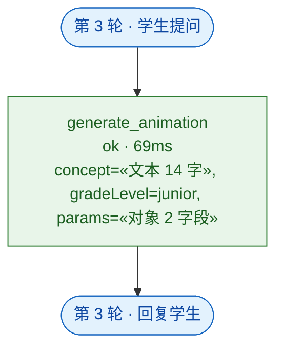

# 工具调用轨迹（自动导出）

> 由 `desktop/src/main/agent/trace.ts` 从 Pi 的 `tool_call` / `tool_execution_start` / `tool_execution_end` 事件导出。**本文件替代原方案的 LangGraph 状态流转图**（执行文档 §9.4 第 4 条）。
> 参数只记摘要：键名 + 规模（`«文本 12 字»`），密钥与个人信息类键一律省略 —— 轨迹图是要进报告与汇报 PPT 的，不落原始输入是数据合规要求。

- 生成时间：2026-09-22T02:32:21.436Z
- 轮数：3
- Tool 调用次数：1
- 模型：deepseek/deepseek-flash

## 调用明细

| # | 轮次 | Tool | 参数摘要 | 结果 | 耗时 | 降级 | 备注 |
| --- | --- | --- | --- | --- | --- | --- | --- |
| 1 | 3 | generate_animation | concept=«文本 14 字», gradeLevel=junior, params=«对象 2 字段» | ok | 69ms | — |  |

